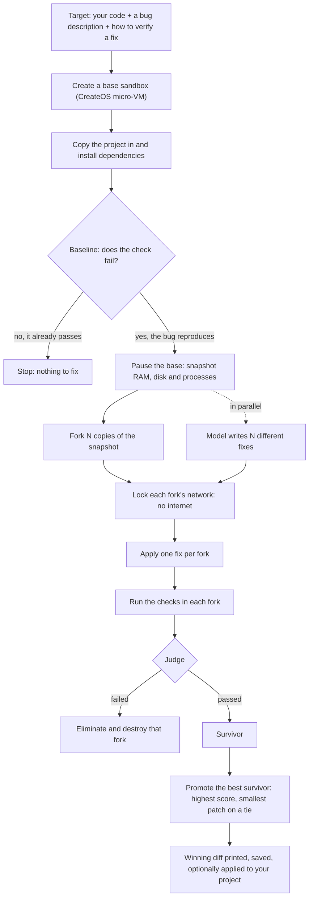
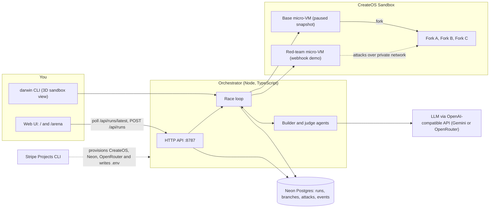
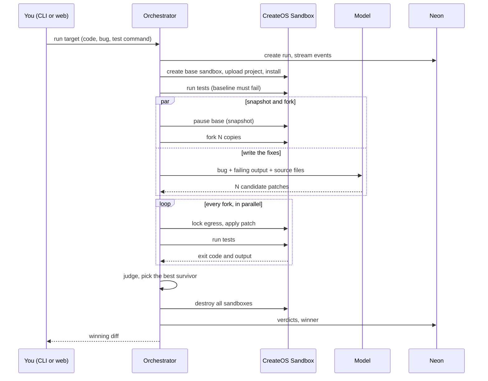
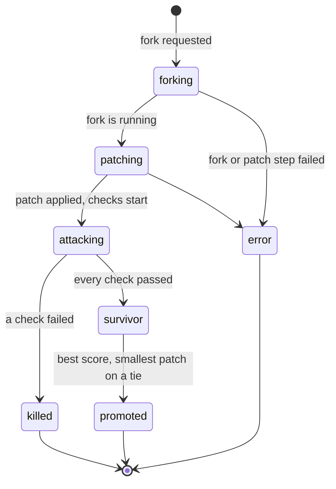

# Darwin

**Natural selection for agent-written code.**

Coding agents write fixes fast, but you can't trust any single patch and you shouldn't run untrusted code on your own machine. Darwin snapshots your project inside a [CreateOS](https://createos.sh) micro-VM, **forks it into parallel copies**, has a model write a *different* fix in each copy, locks every copy off from the internet, and lets **your own tests (or an attack suite) decide which fix survives**. Only the survivor is promoted.

Built for the **CreateOS × Stripe Projects "Build Agents That Run Code" hackathon**. The whole stack is provisioned with **Stripe Projects**, and every line of agent-written code runs inside the **CreateOS Sandbox**, never on the host.

> **Live:** https://darwin-tr7p.onrender.com (browse freely; starting a race needs an access token, see Deploying) · **Links:** demo video: [on YouTube](https://youtu.be/qDYPMc4AKAQ) · post: [on X](https://x.com/dakshcodez/status/2111599754954391560) · leaderboard: [vote for darwin](https://projects.dev/vote/darwin)

---

## How a run works



Two ways to decide what "fixed" means:

| Mode | Verdict comes from | Used for |
|---|---|---|
| **Your tests** (`command`) | The project's own test command, run inside every fork (`npm test`, `pytest`, ...) | Any project that has tests. This is the "bring your own code" path. |
| **Attack suite** (`http-attack`) | A red-team sandbox that attacks each fork over a private network | The built-in webhook demo (`service/`) |

## Architecture



## Sequence of one race (test-based mode)



## What each candidate goes through



## Why a sandbox, not your laptop

Agent-written patches and attack scripts are **untrusted code**. A permission prompt is a policy, not a boundary. In a CreateOS micro-VM, that code gets its own kernel, no inbound access, and an **egress allowlist enforced outside the VM**. Darwin locks every fork to nothing (or to hosts you list) while its tests run, so a malicious or buggy patch can't reach your files, your keys, or the network. A fork also copies **running memory and processes**, which a git worktree cannot.

## Built on Stripe Projects and CreateOS Sandbox

**Stripe Projects** provisions the whole stack from the terminal and syncs credentials to `.env`:

```bash
stripe projects init darwin
stripe projects add createos/free && stripe projects add createos/project   # compute
stripe projects add neon/free     && stripe projects add neon/postgres      # run history
stripe projects add openrouter/api                                          # LLM access
```

Every run opens by reading the project's stack back from `stripe projects status`, so the provisioning is visible in the event feed.

**CreateOS Sandbox features used:** create, file upload, exec, managed processes, **pause**, **fork**, resume, **egress allowlist**, **private networks**, destroy.

## Quick start

Prerequisites: Node 20+, a Stripe account (a free one is fine), a CreateOS account with room for **5 concurrent sandboxes** (forking needs it), and an LLM key.

```bash
git clone https://github.com/dakshcodez/darwin && cd darwin
npm install

# provision the stack (see above), then:
npm run db:apply        # create the Neon tables
npm run doctor          # checks config, CreateOS auth, Neon, LLM key
```

Add an LLM. Darwin talks to any OpenAI-compatible endpoint. Google's free Gemini tier works:

```bash
# .env (never commit this file)
OPENROUTER_BASE_URL=https://generativelanguage.googleapis.com/v1beta/openai
OPENROUTER_API_KEY=<your Google AI Studio key>
DARWIN_MODEL=gemini-3.8-flash
DARWIN_MODELS=gemini-3.8-flash,gemini-flash-latest,gemini-3-flash-preview   # rotated when one hits its daily quota
```

Run it:

```bash
./darwin run --example slugify          # a tiny project with failing tests
./darwin run --example webhook          # the buggy Stripe webhook service, attacked over HTTP

DARWIN_AGENTS=real npm run dev          # web UI at http://localhost:8787 (landing page) and /arena (live dashboard)
```

## Use it on your own code

```bash
./darwin run ./my-project --bug "login crashes on an empty email" --test "npm test"
./darwin run https://github.com/you/public-repo --bug "..." --test "pytest -q" --install "pip install -r requirements.txt"
```

Or put the settings in a `darwin.json` in the project:

```json
{
  "bug": "slugify() mishandles accents and repeated separators",
  "test": "npm test",
  "install": "npm ci",
  "egress": [],
  "n": 3,
  "editable": "auto"
}
```

| Command / flag | What it does |
|---|---|
| `darwin run <path or git URL>` | Race fixes for that project |
| `--bug`, `--test`, `--install` | What is broken, how to verify, one-time setup |
| `-n 2..4` | Candidate fixes (default 3) |
| `--egress <host>` | Let forks reach a host while testing (default: none) |
| `--apply` | Write the winning files into your project (default: save a patch under `.darwin/`) |
| `--flat` / `--plain` | Flat boxes instead of 3D cubes / no live view |
| `darwin status`, `darwin cleanup`, `darwin examples` | Latest run, remove leftover sandboxes, list examples |

The model reads your source files and tests (tests are read-only context) and is told never to modify them. Git URL support clones public repos only and has had little testing. Limits today: projects whose tests need the network, and very large repos.

## The live views

- **CLI:** each sandbox is drawn as a 3D cube that reflects its state: materializing while cloning, scanned by a sweep while tests run, dissolving when eliminated, glowing when promoted. `npx tsx cli/iso-demo.ts` shows the gallery.
- **Web:** `/arena` shows each candidate's real sandbox name, IP, patch diff, check results and score, plus the event feed. It has a target picker, and works on screens from phone width to desktop.

## What we measured

Real runs on CreateOS (one-sample timings, so treat them as indicative):

| Step | Typical time |
|---|---|
| Create a sandbox and upload a small project | about 1 to 2 s |
| Pause the base (snapshot) | 4 to 15 s |
| Fork 3 copies in parallel (healthy) | 7 to 16 s |
| Apply a patch and run a small test suite in a fork | 2 to 7 s |
| Whole race | about 2 to 5 minutes (longer when a fork stalls) |

Honest caveats:

- **Forks sometimes stall.** Roughly one in three exceeded our 75 s limit. Darwin destroys the stuck fork and substitutes a **fresh sandbox from the same files** (no copied RAM), and the event feed labels which candidates were true forks. Resuming the paused base can stall too, so a running fork can stand in as the red team.
- **Snapshot operations are slow to release slots.** Destroyed sandboxes keep counting against the concurrency cap for a while, so Darwin keeps one slot spare, waits for leftovers, and shrinks the candidate count rather than hit the cap exactly.
- **Google's free Gemini tier allows 20 requests per day per model**, which is why the builder rotates through several models.
- The SDK's HTTP/2 transport can crash on a response with no status, so all CreateOS calls go through plain `fetch`.

## Configuration

| Variable | Purpose |
|---|---|
| `CREATEOS_PROJECT_API_KEY` | CreateOS key written by Stripe Projects (mapped to the SDK's key) |
| `CREATEOS_SANDBOX_URL`, `CREATEOS_SANDBOX_BASE_URL` | Sandbox API endpoint (CLI / SDK). Defaults to `https://api.sb.createos.sh`. The hackathon organizers asked participants to use the EU endpoint (`https://api-eu.sb.createos.sh`); we moved to the standard one because EU pause, fork and resume stalled more often in our tests. Set both variables to the EU URL to switch. |
| `NEON_POSTGRES_CONNECTION_STRING` | Run history database |
| `OPENROUTER_API_KEY`, `OPENROUTER_BASE_URL` | Any OpenAI-compatible LLM endpoint and key |
| `DARWIN_MODEL`, `DARWIN_MODELS` | Model for the webhook demo; rotation list for test-based mode |
| `DARWIN_AGENTS=real` | Use the webhook demo's real agents (`agents/`) instead of stubs |
| `STRIPE_WEBHOOK_SECRET`, `DARWIN_TRIGGER_EVENT` | Let a signed Stripe test event start a race |
| `DARWIN_ADMIN_TOKEN`, `DARWIN_MIN_INTERVAL_SEC` | Access token and minimum seconds between race starts (see Deploying) |

## Deploying

`render.yaml` is a Render Blueprint for a single web service that serves the API, the landing page and `/arena`. It must stay a **single instance** (the server keeps "a race is running" in memory). Secrets are `sync: false` and are set in Render, never in git:

```bash
render blueprints validate render.yaml
render services create --name darwin --type web_service --repo https://github.com/<you>/darwin --branch main \
  --runtime node --plan free --build-command "npm ci --include=dev" --start-command "npx tsx orchestrator/server.ts" \
  --health-check-path /api/health --num-instances 1 --env-var KEY=VALUE ...
```

Starting a race spends sandboxes and LLM quota, so a hosted server is protected: `POST /api/runs` needs the `DARWIN_ADMIN_TOKEN` in an `x-darwin-token` header (the arena asks for it once per tab), starts are rate-limited (`DARWIN_MIN_INTERVAL_SEC`, 240 s by default when hosted), a hosted server with no token refuses all starts, and no CORS headers are sent. Reading runs stays public. On Render's free plan the service sleeps when idle, so the first request after a pause is slow.

## Project layout

```
cli/            the darwin CLI and its 3D renderer
orchestrator/   race loops, CreateOS wrapper, API server, target loader, builder, database layer
agents/         the webhook demo's builder, attack suite and judge
service/        the deliberately buggy Stripe webhook service
examples/       slugify: a second target with failing tests
ui/             landing page and live arena dashboard
contracts/      shared types and the Neon schema
infra/          doctor, cleanup, smoke test, local benches (check:agents, check:target)
```

Handy scripts: `npm run doctor`, `npm run smoke` (live fork test), `npm run check:agents`, `npm run check:target -- --example slugify` (no sandboxes), `npm run cleanup`.

## Team

Built during the hackathon by [@dakshcodez](https://github.com/dakshcodez) and [@prakartii](https://github.com/prakartii).
